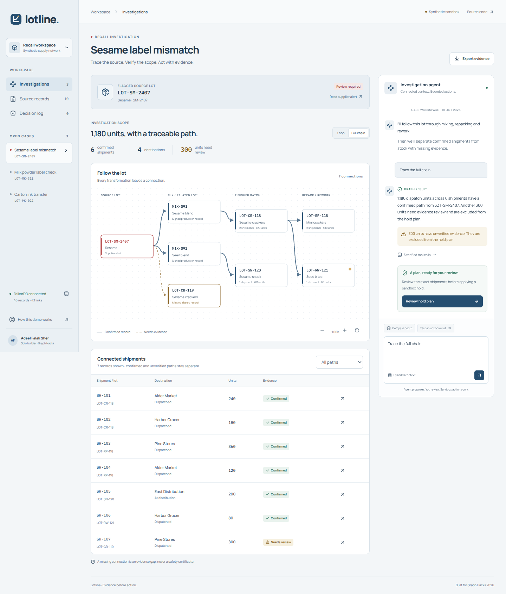
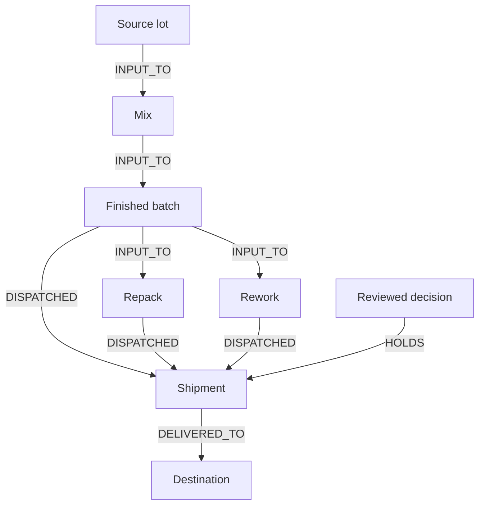

# Lotline

Trace the lot. Review the evidence. Act on the confirmed scope.

A working recall investigation agent for **Graph Hacks: Context for AI Agents**, built by **Adeel Falak Sher**, solo.

**Track: Agents That Act on Connected Data**

[Open the workspace](https://lotline-27e8ldgam-adeelfalaksher900-creators-projects.vercel.app) · [Watch the 1080p demo](demo/Lotline_Demo_1080p.mp4) · [Graph model](docs/ARCHITECTURE.md) · [Cypher tools](queries) · [Research](docs/RESEARCH.md) · [Technical walkthrough](docs/BUILDER_GUIDE.md) · [Build write-up](docs/BLOG.md)



## The problem

A supplier flags a source ingredient, but finished stock has different identifiers. Mixing, repacking and rework carry that ingredient through several transformations. An operations analyst needs the downstream shipment scope and its supporting records before deciding what to hold.

Lotline connects that lineage in FalkorDB. The agent selects a fixed graph tool, the database returns the paths, and an operator reviews the exact confirmed shipment set before a sandbox hold is recorded.

## A demonstration you can verify

| Same fictional source: LOT-SM-2407 | Result |
| --- | --- |
| One transformation hop | 0 confirmed dispatch units |
| Full six-hop traversal | 1,180 units across 6 confirmed shipments |
| Unsigned shift note | 300 units kept in evidence review |
| Separate supplier lot | 450 units with no path from the flagged lot in this fixture |

The 1,180 units include repacked and reworked stock. Shipments count once even when several paths reach them. Missing evidence never becomes a statement that stock is safe.

These are fixture facts, not customer outcomes, regulatory determinations or speed benchmarks. Every supplier, shipment, document and destination is fictional.

## Why FalkorDB is central



- FalkorDB owns the connected context and decision graph.
- The JSON fixture is ingestion input. It is never used as a fallback query engine.
- One Cypher traversal returns each shipment together with its material path and source IDs.
- Removing the database makes scope investigation and action planning unavailable.
- The language model never writes Cypher and never approves a hold.

The graph starts with 46 domain nodes and 43 domain relationships: 17 lots, 11 shipments, 5 destinations, 3 suppliers and 10 source records. Decisions add graph state after approval.

## Run locally

Verified setup: Ubuntu 24.04 with glibc 2.39, Python 3.12 and Node.js 24. Use a compatible Linux environment for the embedded native engine. The optional remote FalkorDB connection avoids running that engine in the application host. Windows users should use WSL2 with a compatible distribution.

```bash
git clone https://github.com/adeelfalaksher900-creator/lotline.git
cd lotline
python3 -m venv .venv
source .venv/bin/activate
python3 -m pip install --upgrade pip
python3 -m pip install -r requirements.txt
npm ci
npm run build
python3 -m uvicorn app:app --host 127.0.0.1 --port 8000
```

Open http://127.0.0.1:8000. No graph account is required. The official FalkorDBLite package supplies the real native engine, which Lotline launches on loopback TCP. The embedded graph is a temporary sandbox and resets when its process restarts or after one hour without workspace activity. Each process admits at most 64 active embedded workspaces; existing workspaces are not evicted to admit a new visitor. Managed graphs are not expired by the app.

For frontend development, run the API in one terminal, then `npm run dev` in another. Vite proxies `/api` to port 8000.

### Persistent FalkorDB connection

Point `FALKORDB_URL` at your own FalkorDB instance before starting the API. Use TLS (`rediss://`) for a remote instance. Keep credentials in environment variables, never source code.

```bash
export FALKORDB_URL='redis://localhost:6379'
python3 -m uvicorn app:app --host 127.0.0.1 --port 8000
```

The optional [Docker Compose file](docker-compose.yml) binds graph ports to loopback and mounts a data volume. The embedded hosted demo is not a substitute for persistent hosting.

### Enable language-model tool selection

Without a planner, the local intent router still invokes the same real graph tools and labels its mode in the trace. To use an LLM, deploy [workers/planner.js](workers/planner.js) with a Workers AI binding named `AI`, a server-only secret `PLANNER_KEY`, and a rate limiter named `RATE_LIMITER`. Set `LOTLINE_PLANNER_URL` and `LOTLINE_PLANNER_KEY` on the FastAPI server. Set a stable random `LOTLINE_SESSION_SECRET` for hosted deployments. See [.env.example](.env.example).

The planner accepts a bounded question and selected lot, and returns only a validated tool name and lot ID. The server independently binds the lot explicitly requested in the question (or the selected case), so a model response cannot silently substitute another lot. It receives no real customer information. Cloudflare's applicable quotas or charges are separate from this project.

## Essential Cypher

```cypher
MATCH p=(root:Lot {id:$lot_id})-[:INPUT_TO*0..6]->(lot:Lot)
OPTIONAL MATCH (lot)-[dispatch:DISPATCHED]->(shipment:Shipment)-[delivery:DELIVERED_TO]->(site:Site)
RETURN lot.id AS lot_id,
       [n IN nodes(p) | n.id] AS path,
       [r IN relationships(p) | r.source_id] AS source_ids,
       [r IN relationships(p) | r.evidence] AS evidence,
       dispatch.evidence AS dispatch_evidence,
       delivery.evidence AS delivery_evidence,
       properties(shipment) AS shipment,
       properties(site) AS site
```

`$lot_id` is a bound parameter. Depth is chosen from a fixed 1-to-6 catalogue. All transformation, dispatch and delivery evidence must be confirmed before a shipment enters a hold. Truncated scope is explicitly partial and cannot produce a plan. The full product queries, including source retrieval and history, are in [queries/](queries). The action write is in [backend/actions.py](backend/actions.py).

## Tools and MCP

| Tool | What it does |
| --- | --- |
| investigate | Resolve a lot and return bounded downstream scope with paths and records |
| compare_depth | Run the same source at one hop and six hops |
| explain_path | Return the graph evidence for one named shipment |
| history | Read reviewed decisions |

The website invokes the validated Python graph tools directly. The optional read-only MCP server exposes the same capabilities to an MCP host. It does not expose an approval or mutation tool.

```bash
python3 -m pip install -r requirements-mcp.txt
python3 -m backend.mcp_server
```

Use that module as a stdio MCP server. `LOTLINE_MCP_WORKSPACE` selects its isolated sandbox graph. External MCP host state is separate from an anonymous web session.

## The review boundary

Review tokens and session cookies use separate signature purposes. A hold plan signs the workspace, lot, exact confirmed shipment IDs, graph revision, nonce and ten-minute expiry. The review dialog shows included and excluded stock. Commit verifies the signature, workspace, explicit approval, expiry and current scope. A conditional graph write records the decision, links its shipments, updates stock status and advances the revision. Retrying the same completed intent returns the original receipt.

Every action is synthetic. No supplier, customer, warehouse or ERP service is contacted.

## Verification

```bash
python3 -m pip install -r requirements-dev.txt
python3 -m pytest tests -q
python3 scripts/verify_mcp.py
npm run typecheck
npm run build
```

The graph integration tests cover repack/rework scope, duplicate counting, unknown and injection inputs, unverified evidence, exact holds, expired/tampered/stale tokens, idempotency, cross-workspace plans, CSRF and full-origin checks, chunked-body limits, planner entity binding, capacity/idle expiry and a truncated-scope guard. They execute actual FalkorDB. The MCP verification initializes a protocol session, lists the four tools, runs the depth comparison and tests an unknown lot.

Current verification evidence and open limits are recorded in [docs/VERIFICATION.md](docs/VERIFICATION.md). Read it for the tested deployment rather than assuming every environment is identical. The [final product review](docs/FINAL_REVIEW.md) records the corrected flows and current screenshots.

## Design and hosting

React, TypeScript and Vite provide the workspace. FastAPI serves the static build and API. A focused material lineage, equivalent shipment table and source dialogs keep evidence next to the action. The interface self-hosts its fonts, including their OFL licences, and the development server binds to loopback by default. [DESIGN.md](DESIGN.md) owns tokens and [UX-CONTRACT.md](UX-CONTRACT.md) describes behavior.

For a source-based Vercel deployment, choose the FastAPI framework, Python 3.12 and Node 22 or newer. Install with `pip install -r requirements.txt`; the checked-in build command runs `npm ci`, builds the frontend, and prepares the native runtime. Set `LOTLINE_SESSION_SECRET`, `LOTLINE_PLANNER_URL` and `LOTLINE_PLANNER_KEY` as server environment variables. A prebuilt `dist/` folder is not required in Git.

The Vercel native adapter uses checksum-verified, version-pinned Ubuntu shared libraries for the graph child process only. It never replaces host libraries. Native dependency licences and source locations accompany the generated runtime. This adapter is separate from the simpler local or managed-database setup.

## Scope and limits

This is a hackathon prototype with synthetic data. It has no production ERP integration, independent operator validation, regulatory certification, authenticated enterprise roles, or production-scale benchmark. The hosted embedded graph may reset at a cold start or after one hour without activity. Request bodies are streamed into an 8 KB bound, per-process rate-limit bookkeeping is bounded, and health checks do not create a graph. Its anonymous workspace controls are a demo boundary, not enterprise tenant security. Use a managed database and appropriate production identity before extending it to real operations.

## AI assistance

OpenAI Codex assisted with research, implementation, test design, documentation and demo preparation. The runtime planner uses a language model through Cloudflare Workers AI. The narrated demo uses ElevenLabs. Adeel Falak Sher is the solo participant. The [builder guide](docs/BUILDER_GUIDE.md) explains the model, queries, architecture and decisions for participant review.

## Licence

Project source: [MIT](LICENSE). Dependencies retain their own licences. FalkorDB and its embedded/native runtime are third-party components. No private or restricted dataset is included.
