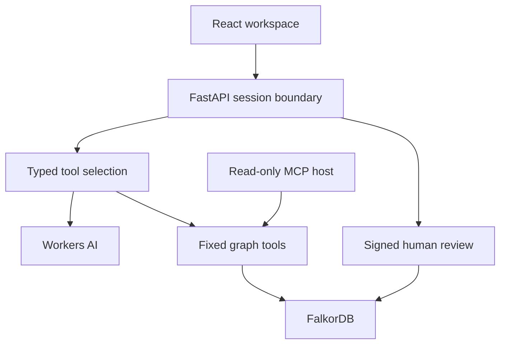
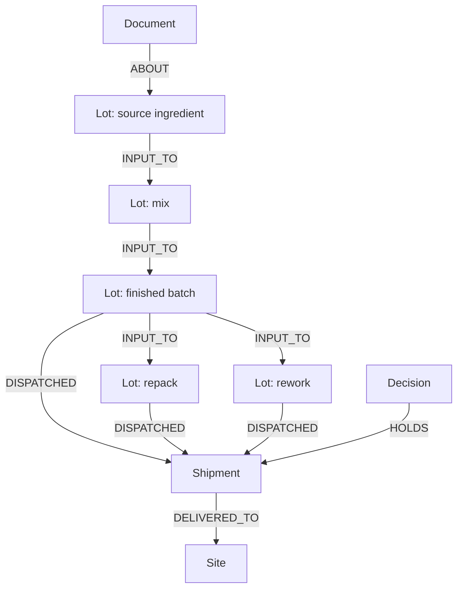

# Architecture and graph model

The LLM selects tools and arguments. Every entity is resolved against the graph. Queries use bound parameters and a fixed depth catalogue. Evidence is returned with the result. FalkorDB stores domain context and reviewed decisions. There is no SQLite, Postgres or JSON fallback for answering a graph question. The checked-in JSON is ingestion data only.

`INPUT_TO` and dispatch edges carry evidence status and source document IDs. Transformations are downstream. A relationship with evidence=unverified is an explicitly modeled possibility, not a confirmed input. A shipment is counted once even if several paths reach it. A confirmed path wins over an unverified alternative.

## Action boundary
A review token covers the workspace, source lot, exact shipment set, graph revision, nonce and expiry. Approval is an explicit UI checkbox. A conditional single graph write creates the decision, connects HOLDS, changes stock status and increments the revision. Replays return the existing receipt. A changed revision or scope requires a new review.

## Isolation and limitations
Anonymous visitors get signed HttpOnly SameSite cookies and isolated graph names. State-changing APIs require a session-bound CSRF header and validate Origin when present. The model endpoint uses a separate server-side key and an edge rate limiter. No key is delivered to the browser. Embedded graphs are ephemeral and process-local; they are not production multi-tenant storage. Session creation and rate limiting are not an enterprise abuse-control system.

## Native hosting adapter
The official Lite wheel's binaries need newer native libraries than the Python serverless host provides. scripts/prepare_runtime.py fetches four version-pinned official Ubuntu packages with SHA-256 verification and extracts the shared libraries and licence notices. Only the FalkorDB child process uses the private dynamic loader. Host libraries are never replaced. The Docker setup provides a simpler alternative for a durable local graph service.
