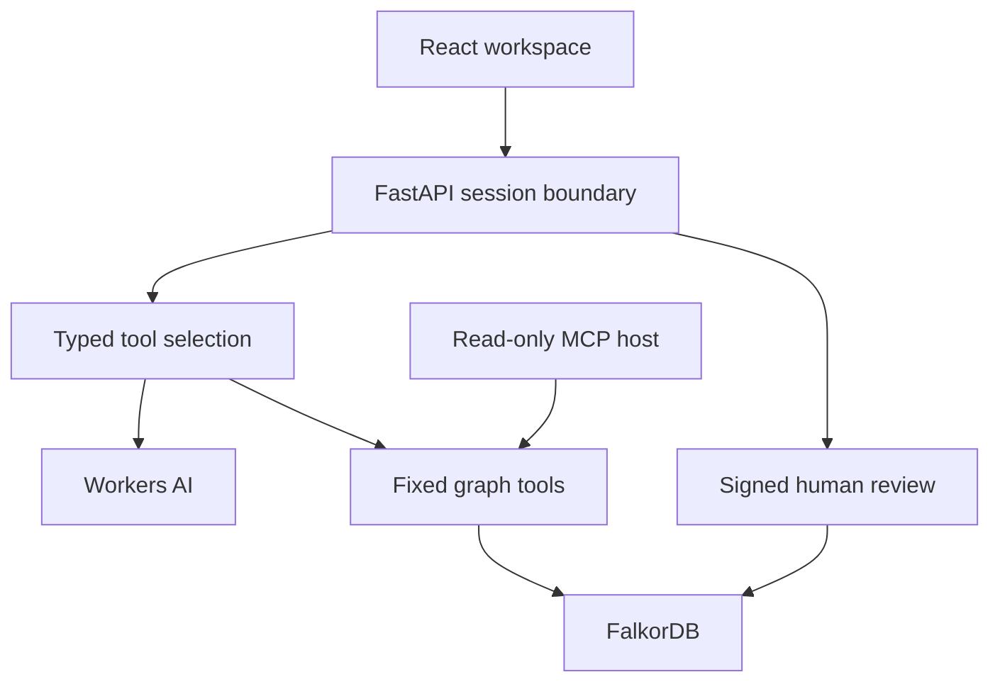
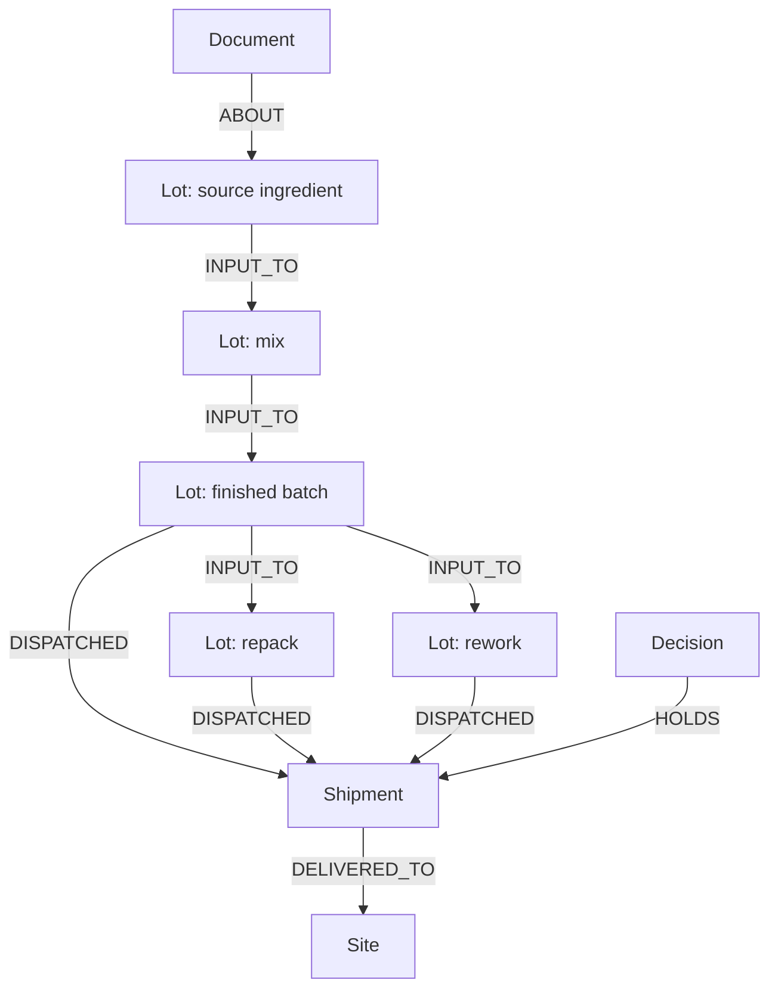

# Architecture and graph model

The LLM selects a tool; the API independently binds entity identity to the explicitly requested or selected lot. Every entity is resolved against the graph. Queries use bound parameters and a fixed depth catalogue. Evidence is returned with the result. FalkorDB stores domain context and reviewed decisions. There is no SQLite, Postgres or JSON fallback for answering a graph question. The checked-in JSON is ingestion data only.

`INPUT_TO` and dispatch edges carry evidence status and source document IDs. Transformations are downstream. A relationship with evidence=unverified is an explicitly modeled possibility, not a confirmed input. A shipment is counted once even if several paths reach it. A confirmed path wins over an unverified alternative.

## Action boundary
Session cookies and review tokens use separate signature purposes. A review token covers the workspace, source lot, exact shipment set, graph revision, nonce and expiry. Approval is an explicit UI checkbox. A conditional single graph write creates the decision, connects HOLDS, changes stock status and increments the revision. Replays return the existing receipt. A changed revision or scope requires a new review.

## Isolation and limitations
Anonymous visitors get signed HttpOnly SameSite cookies and isolated graph names. State-changing APIs require a session-bound CSRF header and validate the complete Origin when present. Body streaming stops at 8 KB; idle rate buckets expire and the bucket table is capped. The model endpoint uses a separate server-side key and an edge rate limiter. No key is delivered to the browser. Embedded graphs are ephemeral and process-local; they are not production multi-tenant storage. The embedded process admits at most 64 active workspaces and expires each after one hour without activity. At capacity it rejects new workspaces rather than evicting existing ones. Health checks do not allocate a graph. Managed database data is not expired by these controls. Session creation and process-local rate limiting are not an enterprise abuse-control system.

## Native hosting adapter
The official Lite wheel's binaries need newer native libraries than the Python serverless host provides. scripts/prepare_runtime.py fetches four version-pinned official Ubuntu packages with SHA-256 verification and extracts the shared libraries and licence notices. Only the FalkorDB child process uses the private dynamic loader. Host libraries are never replaced. The Docker setup provides a simpler alternative for a durable local graph service.

## Evidence completeness
A shipment is confirmed only when every material, dispatch and delivery edge on its returned path is confirmed. The 501st row detects the 500-row scope cap. Partial totals are labelled incomplete, and the action layer refuses to prepare a hold for that result.
