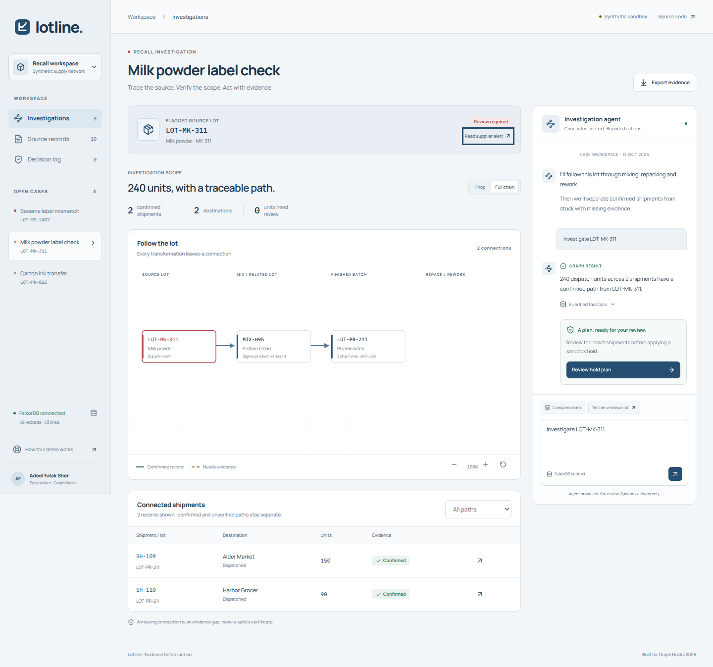
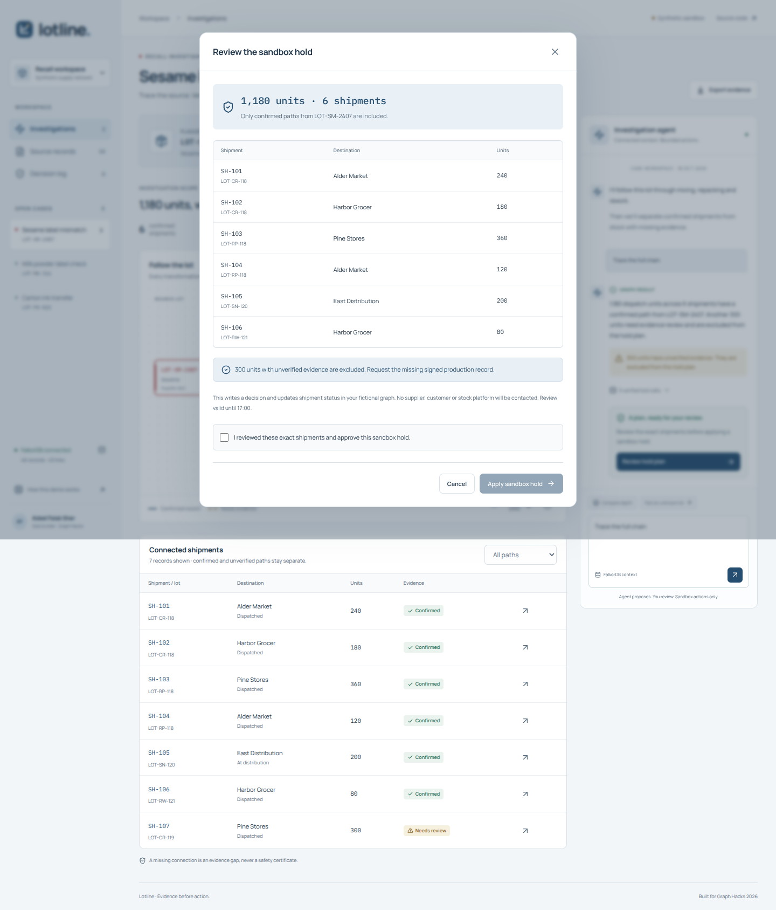

# Final product review

Reviewed on 18 October 2026 against the working synthetic application. This is a focused engineering and user-flow review, not a comprehensive penetration test or a claim of complete accessibility conformance.

| Step | User task | Result |
| --- | --- | --- |
| 1 | Investigate a lot and compare traversal depth | Passed. Zero units at one hop; 1,180 confirmed units and 300 review units at full depth. |
| 2 | Ask about a different lot and open its source | Passed. Milk powder returns 240 units, the correct case title and DOC-09 rather than the previous sesame alert. |
| 3 | Review exact shipments | Passed. Dialog fits, approval starts unchecked, case switching is disabled during requests, and focus returns after closing. |
| 4 | Apply a reviewed hold and retry | Passed locally and on the deployment. Six exact shipments, a graph-backed receipt and idempotent replay. |
| 5 | Enter an unknown lot or use a phone | Passed. Unknown scope offers no alert or action; the mobile page has no horizontal overflow. |

## Corrections

- Bound the requested lot independently of the language model and matched the source alert, case title, depth controls and export to that lot.
- Kept the original result question separate from an editable draft and prevented case changes during pending requests.
- Required confirmed dispatch and delivery evidence as well as transformation evidence. Partial scopes explicitly refuse action planning.
- Separated cookie and review signature purposes, checked the full Origin, and bounded streamed bodies and rate-limit bookkeeping.
- Limited active embedded workspaces to 64 per process, with an hour of idle expiry and no eviction of active visitors. Managed graphs are not expired.
- Fixed the hosted logo, bundled the interface fonts with their licences, updated affected Vite to 7.3.7, and made the UI source readable.

## Captured flow

The screenshots below were captured from the current local application during actual browser regression checks.

## Verification and limits

Thirteen real-FalkorDB tests pass. Six UI states report zero axe rule violations; separate assertions check source attribution, question stability, pending controls, dialog fit, focus, logo loading and mobile overflow. The production frontend build and four-tool MCP protocol check pass. The live deployment passes same-origin requests, actual LLM selection, both lot scopes, unknown input, reviewed hold and replay.

The patched npm dependency audit reports zero known findings. The Python verification environment audit also reports zero after updating its pip installer. Advisory scans cover their checked dependency sets, not the entire host or every possible defect. Machine-readable evidence is linked in [VERIFICATION.md](VERIFICATION.md).

Embedded state remains temporary. This prototype has no real stock integration, operator study, enterprise identity model or production load assessment. The narrated demo still shows the same verified core behavior; its disclosure and production details are in [VIDEO.md](VIDEO.md).
